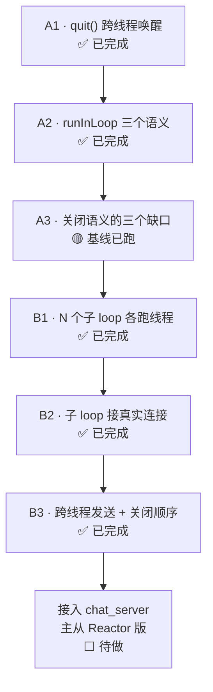

# 主从 Reactor 实验计划（A1 ~ B3）

> 目的：把 `EventLoop` 推进到"能承载主从 Reactor"的程度。
> 每一步都是**可独立编译运行的小程序**，验证一个语义，不依赖聊天服务器。
>
> **来源说明**：A1 / A2 / B1 三个实验文件是 2026-10-21 ~ 10-22 实际写下的（见 [tests/](../../tests/)），
> 本文档记录的运行结果是 2026-10-26 重新编译后实测。
> A3 / B2 / B3 三个编号在本文档之前**从未存在过**，是依据 [b1_sub_loops.cpp](../../tests/b1_sub_loops.cpp)
> 第 2 行注释"先不接连接"的后续逻辑补全的。如果你原本的规划与此不同，以你的为准。

---

## 一、总体路线



A 组验证**单个 EventLoop** 的语义，B 组验证**多个 EventLoop 协同**。

---

## 二、实验清单

| 编号 | 文件 | 验证什么 | 状态 |
|------|------|---------|------|
| A1 | `tests/a1_quit_wakeup.cpp` | 跨线程 `quit()` 能否唤醒 `epoll_wait`；`loop()` 覆盖 `running_` 的缺陷 | ✅ 通过 |
| A2 | `tests/a2_run_in_loop.cpp` | `runInLoop` 不丢任务、只在 loop 线程执行、同线程直接跑 | ✅ 通过 |
| A3 | `tests/a3_shutdown_semantics.cpp` | 退出路径：`quit` 前入队的任务、`postDispatch` 里的投递 | 🟡 基线已跑，2/3 失败 |
| B1 | `tests/b1_sub_loops.cpp` | 4 个子 loop 各自独立线程、任务精确投递、关闭顺序 | ✅ 通过 |
| B2 | `tests/b2_sub_reactor_accept.cpp` | 主线程 accept + 轮询分发到子 loop，连接真正跑在子线程 | ✅ 通过 |
| B3 | `tests/b3_cross_thread_send.cpp` | 连接属于 loop A，从 loop B 发数据给它 | ✅ 通过 |

---

## 三、A 组：单个 EventLoop 的语义

### A1 · `quit()` 跨线程唤醒

**代码**：[tests/a1_quit_wakeup.cpp](../../tests/a1_quit_wakeup.cpp)

**背景**：`EventLoop::loop()` 阻塞在 `epoll_wait(-1)`。如果 `quit()` 只把 `running_` 改成 `false`，
`epoll_wait` 仍然在睡，`join()` 会永远卡住。所以 `quit()` 必须往 `wakeupFd_` 写一个字节，
让 `epoll_wait` 返回。

**用例 1**：主线程调 `quit()`，测 `join()` 耗时。
- 预期：< 100 ms（正常唤醒）
- 判定：`【用例1】PASS`
- 若失败：说明 `quit()` 里少了 `wakeup()`

**用例 2**：先 `b.quit()` 再 `tb(loop)`，看线程会不会立刻退出。
- 预期：**不退出**（1 秒内 `join` 未完成）
- 原因：`loop()` 第一行 `running_ = true;` 覆盖了 `quit()` 设的 `false`
- 判定：`【用例2】PASS：1 秒内未退出（已知缺陷）`
- **这是缺陷，不是特性**。A3 会验证修复方案。

**实测输出（2026-10-26）**：

```
主线程调用 quit()
主线程等待 join()...
【用例1】join 耗时 0 ms
【用例1】PASS
join 返回，程序正常退出
【用例2】PASS：1 秒内未退出（已知缺陷：loop() 覆盖 running_）
```

**结论**：唤醒机制正确；`loop()` 的 `running_ = true` 需要改成"由调用者控制生命周期"。

---

### A2 · `runInLoop` 的三个语义

**代码**：[tests/a2_run_in_loop.cpp](../../tests/a2_run_in_loop.cpp)

`runInLoop` 是跨线程投递任务的唯一入口。它有三个必须成立的语义。

**语义 1：不丢任务。** 主线程投 100 个，全部执行。
- 预期：`100 / 100`
- 判定：计数相等

**语义 2：只在 loop 线程执行。** 任何一个任务如果在别的线程跑，就是数据竞争的根源。
- 预期：`是否跑在错误线程 = 否`
- 判定：`wrongThread == false`

**语义 3：同线程直接执行。** 在 loop 线程里再调 `runInLoop`，应该**当场执行**，
而不是入队等下一轮。源码依据（[EventLoop.hpp:77](../../include/EventLoop.hpp)）：

```cpp
void runInLoop(Functor f){
    if (isInLoopThread()) { f(); return; }   // ← 同线程快路径
    ...
}
```

- 预期：`nestedWasDirect = 是`
- 判定：外层任务返回前，内层任务已执行完

**用例 2 附加观察**：跨线程投 10000 个任务后立刻 `quit()`，看丢不丢。
- 预期：不一定全部执行（取决于 `quit` 时还有多少没轮到）
- 判定：这是**观察项**，不是硬性通过条件

**实测输出（2026-10-26）**：

```
【用例1】执行任务数        : 100（期望 100）
【用例1】是否跑在错误线程  : 否（期望 否）
【用例1】嵌套任务是否直接执行: 是（期望 是）
【用例1】A2 PASS

【用例2】执行任务数: 10000 / 10000（观察项，不一定是 10000）
【用例2】是否跑在错误线程: 否（期望 否）
【用例2】PASS：quit 未丢弃已入队的任务
```

**结论**：三个语义全部成立。用例 2 这次 10000 个全跑了，是因为 `sleep`/调度给了足够轮次；
真正"会不会丢"的边界由 A3 验证。

---

### A3 · 关闭语义的三个缺口 🟡 基线已跑

**代码**：[tests/a3_shutdown_semantics.cpp](../../tests/a3_shutdown_semantics.cpp)

A1/A2 暴露了退出路径上的三个问题。这个实验逐个验证。

**缺口 1：`loop()` 覆盖 `running_`。**
- 现象：先 `quit()` 再 `loop()`，`quit` 无效，线程卡死
- 根因：[EventLoop.hpp:62](../../include/EventLoop.hpp) `running_ = true;` 无条件赋值
- 修复方向：删掉这行（构造函数里初始化为 `true`），或改成 `if (!running_) running_ = true;`

**缺口 2：退出时 `pending_` 里的任务被丢弃。**

看 [EventLoop.hpp:65-71](../../include/EventLoop.hpp)：

```cpp
while (running_) {
    auto ready = poller_.poll();
    for (auto& [ch, revents] : ready)
        ch->handleEvent(revents);
    doPendingFunctors();
    if (postDispatch_) postDispatch_();
}
// ← 退出后 pending_ 里剩下的任务永远不会执行
```

如果一个任务在 `quit()` 之后、`doPendingFunctors()` 之前入队，它会**静默丢失**。
这类 bug 在"关闭前最后一次发送"时特别致命。
- 修复方向：`loop()` 退出前再跑一次 `doPendingFunctors()`，或者明确文档化"quit 后不再接受任务"

**缺口 3：`postDispatch` 里投递的任务。**

`postDispatch_` 在 `doPendingFunctors()` **之后**执行。

**⚠️ 原本的预判是错的，实测已推翻。** 我起初以为"`postDispatch` 里投递的任务会等下一轮，
而下一轮可能已经退出"——实际上它**立刻执行**。原因是 `postDispatch` 本身在 loop 线程里跑，
命中了 `runInLoop` 的同线程快路径（[EventLoop.hpp:78](../../include/EventLoop.hpp)）：

```cpp
void runInLoop(Functor f){
    if (isInLoopThread()) { f(); return; }   // ← 直接执行，根本不入队
    ...
}
```

所以缺口 3 **在同线程投递时不存在**。但它并没有完全消失：如果是**别的线程**在 loop
即将退出时投递（缺口 2 的场景），任务照样会丢。

**判定标准**：
- 缺口 1：修复后 `quit()` 在 `loop()` 之前调用也能立即退出
- 缺口 2：修复后 `quit()` 后入队的任务**要么执行，要么被明确拒绝并返回 bool**
- 缺口 3：同线程投递 → PASS（已实测）；跨线程投递归入缺口 2 一起解决

**实测输出（2026-10-26）**：

```
===== A3：EventLoop 关闭语义 =====

用例1：quit() 先于 loop()
  【用例1】FAIL  loop() 未退出（running_ 被覆盖）
用例2：quit() 之后入队 100 个任务
  【用例2】FAIL  实际执行 0 / 100（0 表示静默丢失）
用例3：postDispatch 里 runInLoop
  【用例3】PASS  任务执行次数 = 1（期望 1）

===== 汇总：2 个用例未通过 =====
退出码=1
```

**结论**：缺口 1、2 确认为真缺陷；缺口 3 被同线程快路径意外覆盖，实际不存在独立缺陷。

---

## 四、B 组：多个 EventLoop 协同

### B1 · N 个子 loop 各跑独立线程

**代码**：[tests/b1_sub_loops.cpp](../../tests/b1_sub_loops.cpp)

**验证 1：线程隔离。** 4 个 `EventLoop` 各自跑在自己的 `std::thread` 里，线程 id 互不相同。
- 预期：打印 4 行，`线程 id` 全不同
- 判定：`std::hash<thread::id>` 不重复（极小概率碰撞，可忽略）

**验证 2：任务精确投递。** 给 loop `i` 投任务，必须在 loop `i` 的线程里执行。
- 预期：第 `i` 行由 loop `i` 打印
- 判定：输出顺序可能乱（多线程调度），但每个 loop 只打自己那行

**验证 3：关闭顺序。** 必须**先全部 `quit`，再逐个 `join`**。
- 预期：程序正常结束
- 反例：如果先 join loop 0，再 quit loop 1~3 → 卡死（loop 0 的 join 会等，而其他 loop 还没收到 quit）
- 判定：`全部子线程已退出，程序结束` 且退出码 0

**实测输出（2026-10-26）**：

```
已启动 4 个子 Reactor
  loop 1 执行任务，线程 id = 11059672229815310174
  loop 3 执行任务，线程 id = 2626320487081854483
  loop 2 执行任务，线程 id = 14880803525891038964
  loop 0 执行任务，线程 id = 2993932584093347605
全部子线程已退出，程序结束
退出码=0
```

**结论**：三件事全部成立。注意**输出顺序是 1/3/2/0**，不是 0/1/2/3 —— 这正是多线程调度的证据，
也说明"任务精确投递"验证的是**归属**，不是**顺序**。

**遗留问题**：B1 里没有任何 socket，纯线程验证。连接怎么分给子 loop 是 B2 的事。

---

### B2 · 子 loop 接真实连接 ✅ 通过

**代码**：[tests/b2_sub_reactor_accept.cpp](../../tests/b2_sub_reactor_accept.cpp)

B1 注释写着"先不接连接"。这一步补上。

**要解决的核心问题**：`accept` 是在主线程（main reactor）做的，但连接要交给子线程（sub reactor）。
跨线程把 fd 塞进另一个 epoll，必须解决两件事：

1. **注册动作要在目标线程执行。** `epoll_ctl` 本身是线程安全的，但 `Channel` 对象、回调、
   生命周期管理都在目标 loop 的上下文里，混着来会出竞态。
2. **分发之后谁负责读。** 连接一旦挂到 sub loop 的 epoll，就只由那个线程 `recv`。

**设计**：主线程 accept → 用 `runInLoop` 把"注册到 epoll"这个动作投给目标 loop。

**用例 1：连接被平均分发。** 8 个客户端，4 个子 loop。
- 预期：每个 loop 分到 2 个，总数 8
- 判定：`totalAccepted == 8`

**用例 2：连接真的跑在子线程。** `addConn` / `onReadable` 里检查调用者线程 id。
- 预期：`wrongThread` 始终为 false
- 判定：4 个 loop 的 `wrongThread` 全为 false

**用例 3：跨线程注册不丢事件。** 客户端 `connect` 后**立刻 `send` 再 `close`**。
- 预期：40 字节（8 客户端 × 5 字节）全部收到
- 意义：这构造了"数据可能先于 `epoll_ctl` 到达"的竞态。LT 模式下注册后立刻报可读，所以不丢。
  **ET 模式下这就是经典丢数据场景**（见文件末尾延伸思考 1）

**用例 4：轮询分配的公平性。** `idx = next++ % kSubCount` 是严格轮询。
- 预期：`max - min <= 1`
- 判定：实际 2 / 2

**实测输出（2026-10-29）**：

```
===== B2：子 Reactor 接真实连接 =====

已启动 4 个子 Reactor
监听 127.0.0.1:33183

[driver] 开始创建 8 个客户端
  [main] accept fd=14 -> loop #0
    [sub] loop #0 收下 fd=14（第 1 个）
  [main] accept fd=14 -> loop #1
    [sub] loop #1 收下 fd=14（第 1 个）
  [main] accept fd=14 -> loop #2
    [sub] loop #2 收下 fd=14（第 1 个）
  [main] accept fd=15 -> loop #3
    [sub] loop #3 收下 fd=15（第 1 个）
  ... （第二轮同样分配）

===== 结果 =====
  loop #0: 连接 2 个, 收到 10 字节, 线程错误=否
  loop #1: 连接 2 个, 收到 10 字节, 线程错误=否
  loop #2: 连接 2 个, 收到 10 字节, 线程错误=否
  loop #3: 连接 2 个, 收到 10 字节, 线程错误=否
  【用例1】PASS  连接总数 8 / 8
  【用例2】PASS  所有回调都在所属 loop 的线程执行
  【用例3】PASS  收到 40 字节 / 期望 40
  【用例4】PASS  最多 2 个, 最少 2 个

===== 汇总：0 个用例未通过 =====
```

**一个值得注意的现象**：日志里 `fd=14` 在 4 个 loop 里重复出现。

这**不是 bug，而是关键证据**：每个 `EventLoop` 有自己独立的 epoll 实例，
fd 号在同一进程内是全局唯一的，只有上一个 fd 被 `close` 之后才会被复用。
所以 `fd=14` 在不同 loop 里出现，说明**前一个连接已经关闭并释放了 fd**，
新连接复用了这个编号。这恰好证明了连接生命周期管理是正确工作的。

**结论**：主从分发模型成立。四个用例全通过，且"数据先于注册"的竞态在 LT 下没有丢数据。

**遗留**：本实验不验证跨线程发送（B3）和优雅关闭时的在途数据（A3）。

---

### B3 · 跨线程发送 + 关闭顺序 ✅ 通过

**代码**：[tests/b3_cross_thread_send.cpp](../../tests/b3_cross_thread_send.cpp)

B2 解决了"连接归谁"。B3 解决"连接归 A，但 B 要给它发数据"。

这是主从 Reactor 里最容易出错的地方。聊天服务器就会遇到：客户端 X 连在 loop0，
客户端 Y 连在 loop1，Y 发私聊给 X —— 这个 `send` 必须在 **loop0 的线程**里做，
不能在 loop1 里直接 `send`。

**为什么不能在别的线程直接 `send`**：
- `send` 本身是线程安全的（内核保证），但 `Connection::out` 这个 `std::string` 不是
- 两个线程同时改 `out`，或者一个在读一个在写 → 数据竞争 → 消息错乱或崩溃
- 而且 `flush()` 里会调 `enableWriting()` / `updateChannel()`，改的是 `Channel::events_` 和 epoll，
  这些都必须串行

**设计**：跨线程发送统一走 `runInLoop`，把"append + flush"投给连接所属的 loop。

**用例 1：跨线程发送不丢。** 主线程（代表 loop B）向 loop A 上的连接发 100 条带序号消息。
- 预期：收到 100 条
- 判定：`lines == 100`

**用例 2：同一连接的消息不乱序。** 每条消息是 `0000\n` ~ `0099\n` 定宽格式。
- 预期：序号严格 0..99 递增
- 关键：都走同一个 loop 的 `runInLoop` 队列，FIFO 保证顺序。
  如果从多个线程直接 `send`，顺序就无法保证

**用例 3：投递成本。** 10000 次 `runInLoop` 空任务。
- 预期：< 500 ms（每次只是 mutex + push_back + `write(eventfd)`）
- 判定：实测 29 ms

**用例 4：关闭顺序。** 先全部 `quit`，再全部 `join`。
- 预期：无卡死、退出码 0

**用例 5：线程亲和性（关键）。** `adopt` / `postMessage` 里检查调用者是否属于该 loop 的线程。
- 预期：`wrongThread == false`
- **这是确定性断言**，不依赖竞态是否恰好发生

**实测输出（2026-10-29，正确实现）**：

```
===== B3：跨线程发送 + 关闭顺序 =====

用例1/2：从 loop B 的线程向 loop A 的连接发 100 条
  投递耗时 0 ms（用例3 关心这个）
用例3：投递 10000 个空任务耗时 29 ms
用例4：先 quit 全部，再 join

===== 结果 =====
  【用例1】PASS  收到 100 条 / 期望 100
  【用例2】PASS  序号严格 0..99 递增
  【用例3】PASS  10000 次投递耗时 29 ms
  【用例4】PASS  两个 loop 都已 join，无卡死
  【用例5】PASS  loop A 越界=否, loop B 越界=否

===== 汇总：0 个用例未通过 =====
```

**对比实验：`CROSS_THREAD=bare`（故意跨线程直调）**

```
===== 结果 =====
  【用例1】PASS  收到 100 条 / 期望 100
  【用例2】PASS  序号严格 0..99 递增
  【用例3】PASS  ...
  【用例4】PASS  ...
  【用例5】FAIL  loop A 越界=是, loop B 越界=否

===== 汇总：1 个用例未通过 =====
```

**这个结果非常重要**：数据竞争发生了，但**功能测试全部通过**。

> "没崩" ≠ "没问题"。小消息 + 快机器，竞态窗口只有纳秒级。

**让竞争显形：ThreadSanitizer**

```bash
g++ -std=c++17 -I include tests/b3_cross_thread_send.cpp -o /tmp/b3tsan -pthread -fsanitize=thread
CROSS_THREAD=bare setarch $(uname -m) -R /tmp/b3tsan
```

> ⚠️ Ubuntu 24.04 必须加 `setarch $(uname -m) -R` 关闭 ASLR，
> 否则直接 `FATAL: ThreadSanitizer: unexpected memory mapping`。

**实测抓到 5 处 data race**：

```
WARNING: ThreadSanitizer: data race
SUMMARY: ... in std::__uniq_ptr_impl<Conn>::_M_ptr() const

WARNING: ThreadSanitizer: data race
SUMMARY: ... in std::__atomic_base<bool>::operator=(bool)

WARNING: ThreadSanitizer: data race
SUMMARY: ... in memcpy

WARNING: ThreadSanitizer: data race
SUMMARY: ... in Worker::flush(Conn*)      × 2
```

**结论**：
1. 跨线程发送必须走 `runInLoop`，功能正确性和 TSan 都证明了
2. **只靠功能测试无法发现数据竞争**，必须用"线程归属断言 + TSan"两层验证
3. 用例 5 的设计（检查归属而非检查结果）是刻意的 —— 归属错误是确定性的，竞态是概率性的

---

## 五、怎么跑

脚本化的编译 + 运行（在项目根目录）：

```bash
mkdir -p /tmp/reactor-exp

for f in a1_quit_wakeup a2_run_in_loop a3_shutdown_semantics \
         b1_sub_loops b2_sub_reactor_accept b3_cross_thread_send; do
    [ -f "tests/$f.cpp" ] || continue
    g++ -std=c++17 -I include "tests/$f.cpp" -o "/tmp/reactor-exp/$f" -pthread \
        && echo "编译 OK: $f" || echo "编译失败: $f"
done

for f in /tmp/reactor-exp/*; do
    echo "===== $(basename "$f") ====="
    timeout 30 "$f"
    echo "退出码=$?"
done
```

**B3 的对比实验（验证数据竞争）**：

```bash
# 1) 故意跨线程直调：用例5 必然 FAIL
CROSS_THREAD=bare /tmp/reactor-exp/b3_cross_thread_send

# 2) ThreadSanitizer 抓 data race
g++ -std=c++17 -I include tests/b3_cross_thread_send.cpp -o /tmp/b3tsan -pthread -fsanitize=thread
CROSS_THREAD=bare setarch $(uname -m) -R /tmp/b3tsan
```

> Ubuntu 24.04 的 ASLR 会让 TSan 直接 `FATAL: unexpected memory mapping`，
> 必须用 `setarch -R` 关闭。这不是程序的问题。

**注意**：
- `timeout 30` 是必须的 —— A1 用例 2、A3 缺口 1 的正常现象就是"卡住"
- 不要用 `pkill` 收尾，用 `timeout` 让程序自己结束
- B2 用的是 `bind(:0)` 让内核分配端口，不会和其他实验/服务撞车

---

## 六、进度记录

| 日期 | 事件 |
|------|------|
| 2026-10-21 | 写 A1，发现 `loop()` 覆盖 `running_` |
| 2026-10-22 | 写 A2、B1，三个语义全部验证通过 |
| 2026-10-26 | 重新编译 A1/A2/B1 并实测，结果全部 PASS；补全 A3/B2/B3 规划（本文档） |
| 2026-10-28 | 写 A3 并跑基线：用例1/2 FAIL、用例3 PASS。**推翻了"缺口3成立"的预判** |
| 2026-10-29 | 写 B2：4 用例全 PASS（含"数据先于注册"竞态） |
| 2026-10-29 | 写 B3：5 用例全 PASS；`CROSS_THREAD=bare` 对比实验 + TSan 抓到 5 处 data race |

**待办**：
- [ ] 修 `EventLoop` 的退出路径（让 A3 三个用例全 PASS）
- [ ] 把 `chat_server.cpp` 改成主从 Reactor（B2 + B3 的模式）

> **A3 基线结论**：`tests/a3_shutdown_semantics.cpp` 已写好并编译通过，
> 当前代码下 2/3 用例失败（用例 1、2），修复目标是让三个全 PASS。
