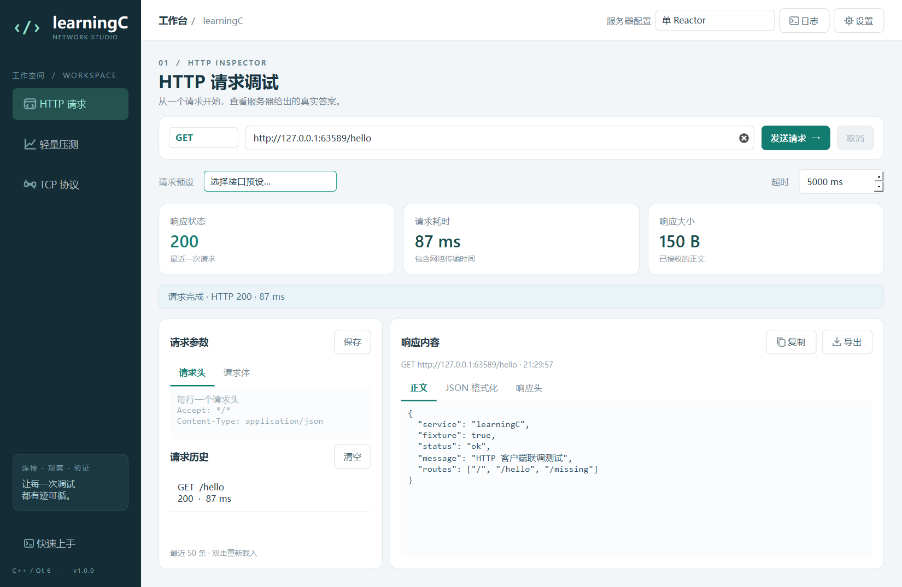

# LearningC Studio：Qt 服务端调试客户端

LearningC Studio 是配合本仓库 Linux C++ 服务端学习的桌面客户端。它提供 HTTP 请求检查、小规模并发测量、TCP 协议调试和日志查看，便于把 Qt 的事件循环、信号槽、网络通信与已有 Reactor 代码联系起来。

这是独立的 **Qt 客户端工程**。Windows 上构建它不需要编译仓库根目录的 epoll 服务端；实际联调时，由用户在 Linux 上启动原有服务端，再填写 Linux 的 IP 地址。客户端不会自动部署或修改服务端。

## 直接运行 Windows 版

当前源码版本 **1.0.2**：同步最新聊天后端的功能说明与 TCP 页面提示。历史截图和 1.0.1 发布包保留原版本标识；本次验证见 [上传记录](docs/PUBLISH.md)。

1.0.1 已修复的问题：TCP 协议调试固定直连输入的服务器，修复系统代理导致的 `The proxy type is invalid for this operation`。此设置仅作用于 TCP 调试 socket，不修改 Windows 的代理配置。验证记录见 [TCP 代理修复](docs/PROXY-FIX.md)。

本仓库提交源码、脚本与文档，不提交 EXE、Qt DLL 或构建缓存。先按下文执行打包脚本生成 `dist/LearningCStudio-windows-x64.zip`；如果已有本地运行包，解压后双击 `learningc_studio.exe`。保留同目录的 DLL 和插件文件夹；运行包已包含 Qt 与 MSVC 运行库，不需要安装 Qt Creator。

在右上角“设置”中填写已经启动的 Linux 服务器地址，然后选择对应的服务器配置。HTTP 默认端口 8080，TCP 默认端口 12735。HTTP 页面是默认首页；历史记录保留在当前进程内，关闭后清空。

以下为 1.0.0/1.0.1 历史界面截图；1.0.2 已更新 TCP 页面的后端能力提示。



截图中的响应由自动化测试夹具产生，演示客户端展示能力。真实后端联调步骤见 [操作演示](docs/DEMO.md)，历史与本次验证范围见 [测试报告](docs/TESTING.md)。

## 从源码构建

Windows 环境需要 Qt 6 的 MSVC 2022 x64 SDK、Visual Studio 2022 的“使用 C++ 的桌面开发”组件，以及 CMake 3.21 或更新版本。Qt 模块为 Core、Gui、Widgets、Network；自动化测试还需要 Test。Qt SDK、编译器和目标程序必须使用一致的架构。

在仓库根目录运行：

```powershell
# 指向自己的 Qt SDK；也可以提前设置环境变量 QT_ROOT。
.\qt-client\scripts\build.ps1 -QtPath 'C:\Qt\6.8.3\msvc2022_64'

# 构建后直接运行，开发运行时需要 Qt DLL 和插件。
$env:PATH = 'C:\Qt\6.8.3\msvc2022_64\bin;' + $env:PATH
$env:QT_PLUGIN_PATH = 'C:\Qt\6.8.3\msvc2022_64\plugins'
.\build-qt\Release\learningc_studio.exe
```

脚本的 Qt 查找顺序是 `-QtPath`、`QT_ROOT`、仓库上一级目录的 `.qt\6.8.3\msvc2022_64`。最后一项适用于当前工作区布局，换机器时应显式指定 SDK 路径。脚本通过 `vswhere` 查找 Visual Studio 2022，不要求先手动运行 `vcvarsall.bat`；CMake 优先取 PATH，其次取 Visual Studio 自带版本。

默认执行 Release 构建和 CTest，任一阶段失败都会停止。`-Configuration Debug` 可选择调试构建；开发时可用 `-SkipTests` 只编译。四套测试必须被 CMake 注册为 `test_http`、`test_benchmark`、`test_tcp`、`test_ui`，避免“没有发现测试”被误报为成功。脚本会给 CTest 子进程配置 Qt DLL、插件搜索路径。

测试详细输出保存在构建目录的 `test_http-results.txt`、`test_benchmark-results.txt`、`test_tcp-results.txt`、`test_ui-results.txt`，失败时可据此定位具体用例。Windows 的 UI 测试需要可用的桌面会话。

### Qt Creator

1. 打开 **`qt-client/CMakeLists.txt`**，选择与 Qt SDK 匹配的 Desktop Kit。Windows 选择 MSVC 2022 x64，Linux 选择对应的 GCC/Clang Kit。
2. 构建目录设置为仓库内 `build-qt-creator` 等独立目录；不要复用其他生成器或编译器产生的 CMake 缓存。
3. 配置 `BUILD_TESTING=ON`，构建并运行 `learningc_studio`。调试时可在请求发起、回复完成、socket `readyRead` 和帧解析处加断点。

### 通用源码构建

Windows 的等价命令如下；`cmake`、`ctest` 需在 PATH 中，Qt 的 `bin` 需在运行时 PATH 中：

```powershell
cmake -S qt-client -B build-qt -G 'Visual Studio 17 2022' -A x64 -DCMAKE_PREFIX_PATH='C:\Qt\6.8.3\msvc2022_64' -DBUILD_TESTING=ON
cmake --build build-qt --config Release --parallel
ctest --test-dir build-qt -C Release --output-on-failure --no-tests=error
```

Linux 需要 C++17 编译器、CMake、Qt 6 开发文件与 Qt Test，以及可用的桌面图形环境。系统包安装方式随发行版而异；如果使用 Qt 官方 SDK，把 `CMAKE_PREFIX_PATH` 指向该 SDK 的 `gcc_64` 目录：

```bash
cmake -S qt-client -B build-qt-linux -DCMAKE_BUILD_TYPE=Release -DBUILD_TESTING=ON -DCMAKE_PREFIX_PATH="$HOME/Qt/6.8.3/gcc_64"
cmake --build build-qt-linux --parallel
ctest --test-dir build-qt-linux --output-on-failure --no-tests=error
./build-qt-linux/learningc_studio
```

使用系统 Qt 时可省略 `CMAKE_PREFIX_PATH`。无显示器的 CI 可设置 `QT_QPA_PLATFORM=offscreen` 运行 UI 测试；交互客户端需要正常的显示环境。

## Windows 打包

```powershell
.\qt-client\scripts\package.ps1 -QtPath 'C:\Qt\6.8.3\msvc2022_64'
```

打包脚本先重新构建 Release 并运行测试，然后调用同一 SDK 的 `windeployqt --release --no-translations --no-opengl-sw --compiler-runtime`。输出为：

```text
dist/LearningCStudio/learningc_studio.exe
dist/LearningCStudio-windows-x64.zip
```

目录中包含 Qt 运行库、平台插件、可用的编译器运行库、README 和 `docs`，以及从 Qt 官方 6.8.3 源码获取的 LGPLv3/GPLv3 文本。脚本还会复制 SDK 内可找到的许可证/声明与 SBOM 文件，并生成包含源码入口的 `QT-NOTICES.txt`。许可来源见 [LICENSES/README](docs/LICENSES/README.md)。换用其他 Qt 版本时，应核对对应版本的源码与第三方声明。验证运行包时，应从解压目录启动，并在没有开发 Qt 环境的目标机器上另做检查。

重复打包会替换上述两个生成物；只有新包完成部署和压缩后才替换旧输出。脚本校验清理路径必须位于本仓库 `dist` 下，并拒绝使用重定向目录。不要把个人文件放进生成的应用目录。

## 连接真实服务端

HTTP 默认端口是 **8080**，TCP 默认端口是 **12735**。Windows 客户端连接 Linux 时，填写 Linux 的可达 IP；`127.0.0.1` 只代表客户端所在的机器。虚拟机需具备正确的桥接、主机网络或端口转发配置。

三个 HTTP 服务端都使用 8080，因此同一台 Linux 机器上要**依次启动**，切换前结束上一版本。不要因为客户端选择了不同服务端说明，就以为远端进程也已切换。

| 服务端目标 | 可复现实验 | 当前源码行为 |
| --- | --- | --- |
| `webserver` | `/`、`/hello`、`/missing` | 前两者返回 200；未知路径返回 404 |
| `webserver_thread` | `/`、`/slow`、`/missing` | `/slow` 等待约 2 秒；响应后关闭连接；未知路径返回 404 |
| `webserver_multithread` | 任意路径 | 返回固定的 200 响应；不能用它验证 404 路由 |
| `chat_server` | 建连后发送 Login，双客户端测试 Say，最后发送 Bye | 返回 Welcome/Users；支持重名检查、群聊和私聊；Bye 触发服务端关闭连接 |

TCP 页面是手动协议调试工具：连接后自行选择 Login、Say 或 Bye，填写负载并点击“发送协议帧”。状态“TCP 已连接”仅表示网络连接成功，客户端不会自动发送 Login，也不会把 Welcome 转换成登录状态。1.5 秒未收到完整响应时只做提示，保持 TCP 连接。最新后端对合法 Login 应返回 Welcome 和 Users；如果没有响应，需要检查服务端版本、输入和日志。发送 Say 前先完成 Login，广播发送者不会收到自己消息的 Chat 回显。自动化测试使用受控服务，不能代替最新 Linux 后端的真实聊天联调。

侧栏包含“HTTP 请求”“轻量压测”“TCP 协议”。顶栏可切换服务器配置、查看日志和设置。`Ctrl+Enter` 发送请求或开始测试，`Ctrl+L` 聚焦地址，`Ctrl+Shift+L` 打开日志。HTTP 历史可双击重放，请求可保存为 JSON；TCP 事件可导出 JSON；测量结果可导出 CSV。

## 如何看待并发测量

默认值为 **100 次请求、并发 4、每次超时 5 秒**，上限为 10000 次、并发 32。每次请求创建新的网络管理器并使用短连接，避免连接池把“设置的并发数”和“实际连接数”混为一谈。

测量只发送 GET，整批在一个专用工作线程调度；每个请求使用独立网络管理器。平均值、P50/P95 只采样完整收到的成功 2xx 响应，吞吐量为 `(已结束数 - 取消数) / 实际秒数`，其中包含 HTTP 错误、网络错误和超时。停止时取消已发起的活动请求，不把尚未发出的计划请求算成取消。

这些数值反映客户端所见的端到端耗时，包括连接建立、网络、服务端处理与客户端调度。GUI、Qt 网络栈和 Windows 调度都会影响结果。它适合检查并发调度、失败、超时和取消行为；**不能把这里的吞吐量直接与 README 中 wrk 长连接测量结果比较，也不能当作服务端性能上限**。做版本对照时应保持机器、URL、网络、连接模式、并发和请求数量一致，并保存原始结果。

## 学习资料与验证范围

- [架构与学习路线](docs/ARCHITECTURE.md)：事件循环、信号槽、线程归属、拆帧和统计口径。
- [可复现演示步骤](docs/DEMO.md)：Windows 客户端连接 Linux 服务端的逐步操作、预期结果和证据边界。
- [本次测试报告](docs/TESTING.md)：构建环境、自动化测试、屏幕缩放和发布包检查结果。
- `docs/screenshots/`：界面截图（以实际生成的文件为准）。

构建和测试命令只是复现入口，不代表已经在某台机器执行成功。最终交付说明中的实际命令输出、截图和远端服务端日志，才是对应验证的证据。自动化测试使用测试专用本地服务；可执行客户端不带演示服务端。
