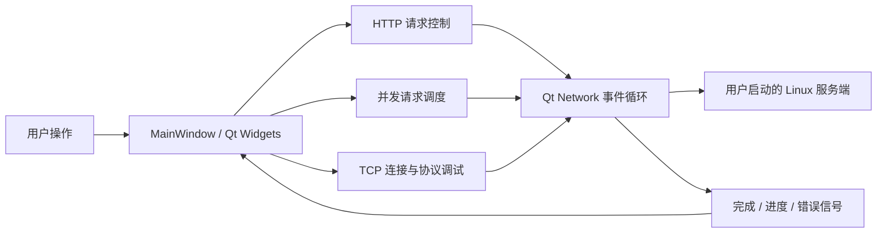

# 客户端架构与学习路线

## 工程边界

`qt-client` 是独立 CMake 项目，目标程序为 `learningc_studio`。Windows 上只配置这个子目录，避免进入使用 Linux epoll、timerfd、eventfd 的服务端构建。它面向现有服务端发起请求；HTTP/TCP 测试中的小型本地服务仅为测试提供可控输入，不随客户端启动。

Qt Widgets 负责界面，Qt Network 负责 HTTP 和 TCP，Qt Test 负责自动化验证。`HttpClient` 位于 `httpclient.h/.cpp`，`BenchmarkRunner` 位于 `benchmark.h/.cpp`，`TcpClient` 位于 `tcpclient.h/.cpp`，`protocol.h` 定义帧编码与解析。网络层通过信号通知界面，不依赖具体控件；界面展示状态、执行用户动作并记录日志。

## 事件循环与信号槽

从按钮点击发出请求后立即返回事件循环。网络读写完成、定时器超时或 socket 状态改变时，Qt 再调用相应槽函数。GUI 线程可以同时处理输入、重绘和多个等待中的连接。

“异步”并不等于“每个请求创建一个线程”。在一个线程的事件循环中，也可以存在多个进行中的请求；并发数描述同时未完成的工作数量。长时间阻塞的槽函数、等待网络的同步循环或大量日志刷新都会影响窗口响应，也会影响客户端测量值。

QObject 有线程归属。网络管理器、socket、定时器应在所属线程中创建、调用并销毁；跨线程沟通应使用合适的信号槽连接，界面控件始终由 GUI 线程访问。当前并发测量使用一个专用工作线程调度整批请求，在该线程内为每次请求创建独立网络管理器；不是每个请求创建一个线程。读代码时先确定对象在哪个线程创建、由谁持有，再讨论是否需要 `QThread`。

| 概念 | Qt 客户端 | Linux 服务端中的对应学习点 |
| --- | --- | --- |
| 等待 IO 事件 | Qt 事件循环、网络信号 | `epoll_wait`、EventLoop 分发 |
| 有数据可读 | `readyRead` | Channel 的读回调 |
| 定时事件 | `QTimer` | timerfd 的超时检查 |
| 安全清理 | 生命周期、`deleteLater`、断开回调 | 避免在回调栈中直接删除正在使用的对象 |
| 消息边界 | HTTP 完成事件或 TCP 长度前缀 | Buffer 累积输入并逐帧提取 |

## HTTP 生命周期

一次请求应只有一个最终结果：成功、HTTP 非成功状态、网络错误、超时或用户取消。定时器触发取消与网络完成可能接近同时发生，清理逻辑必须防止重复统计、重复发出最终信号或继续访问已销毁回复。

HTTP 状态码与网络错误是不同层次的信息。404 表示收到了 HTTP 响应，归为 HTTP 错误；连接拒绝通常没有状态码。即使已经收到 200 响应头，后续传输失败仍是网络错误。超时、主动取消、响应截断分别记录。HTTP 支持有效 ASCII 方法 token，使用 HTTP/1.1、默认 TLS 证书验证和手动重定向；单次超时范围为 1～120000 ms，响应上限为 4 MiB。展示状态码、响应头、正文、字节数和耗时，有助于判断错误在哪一层。

`QNetworkAccessManager` 通常管理连接池。测量模块为每次请求创建独立实例，使用新连接；这能避免共享池对并发观察的干扰，但创建对象和连接的成本也进入客户端观察范围。请求超时适用于每个请求，不是整批测量的总时长。

## 并发调度与统计

调度器维护尚未开始、进行中、已结束的请求。当有请求结束时，只要任务没有停止且还有待发请求，就补充新的请求，直到达到总数或用户停止。进行中的请求数不得超过配置的并发上限。停止操作需要同时终止进行中的请求，并阻止后续补发。

默认 100 次、并发 4、超时 5000 ms；总数上限 10000，并发上限 32。学习时先用很小的数据量，分别观察成功、404、连接拒绝、延迟超时和中途停止。

统计采用以下明确口径：

- `completed` 统计已经发起并结束的请求，包含取消；未发起的计划请求不计入完成或取消。
- 吞吐量为 `(completed - cancelled) × 1000 / elapsedMs`，包含 HTTP 错误、网络错误和超时。因此必须与成功/失败分类一起看。
- 平均值、P50/P95 只采样完整收到的成功 2xx 响应；分位数采用排序后的 nearest-rank，少量样本时容易受单个慢请求影响。
- 测量仅使用 GET，不存储响应正文，不做应用层重试；停止后结果中已结束数可以小于计划总数。

每秒完成数量不等于服务端容量，必须同时看成功/失败数量、测试总时长及客户端资源开销。

CSV 每行对应一次实际发起的请求，并重复批次摘要；26 列包括 UTC 开始时间、标签、URL、总数、并发、超时、协议与连接/采样策略、运行耗时、各类结果数量、吞吐量、平均/P50/P95、请求 ID、状态码、结果、请求耗时、字节数和错误信息。文本按 CSV 转义并防止被电子表格误识别为公式。两次实验如果连接复用策略或网络路径不同，即使数字相差很大，也不能直接推断某种 Reactor 架构更快。

## TCP 帧与连接状态

TCP 传输的是有序字节流，不保证一次发送对应一次接收。协议采用长度前缀，所有整数使用网络字节序（大端）：

| 字段 | 字节数 | 说明 |
| --- | --- | --- |
| Length | 4 | 后续总长度，即 `8 + payload 字节数` |
| Magic | 4 | `0x4C434831`，即 `LCH1` |
| Type | 4 | 消息类型 |
| Payload | 0～65536 | 负载；文本使用 UTF-8 |

线上一帧总长为 `4 + Length`，固定头为 12 字节。接收端先积累不足 4 字节的输入；读出长度后检查是否合法；不足一帧就保留缓冲区等待下次 `readyRead`；完整后提取一帧并继续循环，直至没有完整帧。长度上限应在按长度分配或提取之前检查，非法魔数应作为协议错误处理。

| Type | 名称 | 负载与方向 |
| --- | --- | --- |
| 1 | Login | 客户端→服务端，UTF-8 昵称 |
| 2 | Welcome | 服务端→客户端，确认昵称 |
| 3 | Users | 服务端→客户端，换行分隔的在线昵称 |
| 4 | Say | 客户端→服务端，广播 `B + 正文`；私聊 `D + 目标昵称 + NUL + 正文` |
| 5 | Chat | 服务端→客户端，`模式 + 发送者昵称 + NUL + 正文` |
| 6 | Bye | 客户端→服务端，空负载 |
| 7 | Error | 服务端→客户端，错误文本 |

客户端显示“正在连接…”、“TCP 已连接”、“正在断开（等待发送队列清空）…”和“未连接”等传输状态。它不会自动登录，也不根据 Welcome/Error/Bye 改成业务登录或退出状态；收到的合法帧作为事件展示。连接超时默认为 5000 ms，发送后 1.5 秒没有完整响应时只提示，不强制断开。

发送支持完整帧、100 ms 分段和连续两帧。分段把一帧分两次写入，期间禁止交错发送；连续两帧把两个相同帧拼接后一次写入。操作系统和 TCP 仍可能合并或重新拆分数据，因此不能保证对端恰好进行一次或两次 `recv`。`TX queued` 表示进入本地发送队列，不是对端收到或业务接受的确认。

单帧负载上限为 65536 字节，本地发送队列上限为 1 MiB；未知但有效的消息类型保留，非法长度或魔数导致断开。手动发送 Bye 只发送协议帧，当前聊天服务会主动关闭对应连接；客户端也可另点“断开”；断开操作等待发送队列排空，最长 1 秒后强制终止。如果断开发生在分段发送中，尾段被取消，但前段可能已经到达对端。

当前 `src/chat_server.cpp` 已实现 Login/Welcome、Users 名单、Say → Chat 群发/私聊与 Bye 退出。群发只转发给其他已登录连接；客户端仍保持协议观察工具定位，展示实际收到的帧，不维护联系人或业务登录状态。最新后端真实联调需单独执行，不能由客户端夹具测试推断完成。

## 推荐阅读与面试练习

1. 从 `main.cpp` 和 `MainWindow` 开始，跟踪“用户点击→请求发起→网络完成→界面更新”的信号链。在断点中查看当前线程和对象父子关系。
2. 观察一个立即完成请求和一个超时请求，解释为何不能在按钮槽中等待网络返回，及为何结束路径必须只执行一次。
3. 把 TCP 测试中的一帧分多段发送，再把两帧合在一起发送，逐步查看缓冲区长度变化。解释为何 `readyRead` 不是消息边界。
4. 用小规模并发观察“补充任务”的时机，解释并发数、总请求数、吞吐量和延迟分位数各自描述什么。
5. 对照 Linux 的 EventLoop/Channel/Poller，说明 Qt 事件循环隐藏了哪些系统调用，哪些资源生命周期问题仍需应用负责。
6. 面试演示时分别展示自动化测试、客户端截图和真实后端日志，明确每一项能证明什么，避免把测试服务的能力归给业务服务端。

## 验证边界

四套 CTest 分别检查 HTTP、并发调度、TCP 拆帧/连接和 UI 行为。测试专用本地服务让延迟、错误、分包和粘包可重现；它们提供的是客户端行为证据。Linux 服务端的实际互通仍需按 [DEMO.md](DEMO.md) 人工运行并核对两端结果。

客户端短连接测量不替代 wrk 的长期负载实验。Windows 可运行包在开发机启动，不等于已经在无 Qt SDK 的干净目标机验证；Linux 构建说明存在，也不等于当前交付完成了 Linux 实机构建。
